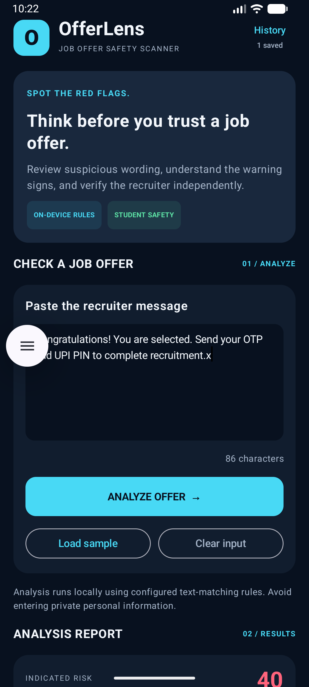

# OfferLens 🔍
### Android App for Job & Internship Offer Safety

OfferLens is a student-focused Android application designed to help students and job seekers review job offers, internship messages, and recruiter communications for common warning signs.

The app uses an **on-device, rule-based text analyzer** to identify potentially suspicious wording, explain matched warning signs, and recommend practical safety checks.

> ⚠️ OfferLens is a screening aid. It cannot guarantee that an offer is genuine or fraudulent.

## 📱 App Screenshot

### Home Screen



## ✨ Features

- **Job Offer Analysis** — Analyze pasted job offers, internship messages, and recruiter communications.
- **Risk Assessment** — View a risk score and risk category based on configured rules.
- **Warning Evidence** — See matched phrases, explanations, and associated points.
- **Positive Signals** — View potentially reassuring signals when detected.
- **Recommended Actions** — Get practical suggestions for verifying an offer.
- **Recruiter Verification Checklist** — Track important employer and recruiter verification steps.
- **Scan History** — Revisit previous analyses saved locally.
- **Sample Messages** — Try example messages to understand the analyzer.
- **Dark Interface** — A modern dark-themed design with cyan accents.

## 🛠️ Tech Stack

| Technology | Purpose |
|---|---|
| Kotlin | Android application logic |
| Jetpack Compose | User interface |
| Material 3 | UI components and styling |
| SharedPreferences | Local scan-history storage |
| JSON | Local history serialization |
| Android Studio | Development environment |
| Git and GitHub | Version control and source hosting |

## ⚙️ How It Works

1. Paste a job offer, internship message, or recruiter communication.
2. Run the analysis.
3. Review the risk category, score, and matched warning phrases.
4. Read the explanations and recommended actions.
5. Independently verify the employer and recruiter before making decisions or sharing information.

## 🚀 Getting Started

### Requirements

- Android Studio
- Android SDK compatible with the project
- An Android device or emulator

### Run the Project

1. Clone the repository:

   ```bash
   git clone https://github.com/rajaryansharma56-dot/OfferLens.git
   ```

2. Open the `OfferLens` project in Android Studio.
3. Allow Gradle to sync.
4. Run the application on an Android device or emulator.

## 🔐 Privacy

Message analysis is performed on-device by the rule-based analyzer. Scan history is stored locally using SharedPreferences.

This describes the current app implementation and is not a guarantee about Android backup settings or other device-level behavior.

## ⚠️ Limitations

- OfferLens uses rule-based text matching, not a validated machine-learning fraud detection model.
- The risk score is **not a probability** that a message is fraudulent.
- A high-risk result does not conclusively prove fraud.
- A lower-risk result does not guarantee that an offer is legitimate.
- Scams may use wording that the current rules do not recognize.
- Always verify offers through official company websites and independently obtained contact details.
- Never share OTPs, UPI PINs, passwords, or other authentication secrets with recruiters.

## 🎯 Project Goal

OfferLens aims to make basic job-offer safety checks more accessible to students and job seekers through a simple Android application.

## 👨‍💻 Author

**Raj Aryan Sharma**

- GitHub: [rajaryansharma56-dot](https://github.com/rajaryansharma56-dot)
- Project Repository: [OfferLens](https://github.com/rajaryansharma56-dot/OfferLens)

## 📄 Disclaimer

OfferLens is an educational safety-support tool. It does not guarantee scam detection and does not replace independent verification or professional advice.
